# Консолідація даних з різнорідних джерел

Програмна частина магістерської роботи на тему «Інформаційна технологія консолідації та підвищення якості даних з різнорідних джерел».

## Призначення

Дані про ті самі об'єкти часто зберігаються в кількох місцях: реєстр у Excel, вивантаження з сайту в JSON, стара база в SQLite. Колонки в них називаються по-різному, дати й телефони записані в різних форматах, одні й ті самі заклади, люди чи товари трапляються по кілька разів, а частина значень відсутня. Щоб працювати з такими даними, їх треба звести в одну таблицю, де кожен об'єкт записано один раз і в однаковому вигляді.

Ця програма робить це автоматично. На вході — кілька файлів, на виході — одна консолідована таблиця і звіт про те, що змінилося і наскільки покращилася якість даних.

Головна особливість: програмі не потрібно нічого знати про дані заздалегідь. Їй не треба показувати приклади дублікатів чи налаштовувати правила під конкретну таблицю. Як порівнювати колонки, які записи вважати одним об'єктом і чи є повтори всередині одного файлу, вона визначає сама, за статистикою самих даних. Якщо людина хоче, вона може відповісти на кілька питань «це той самий об'єкт чи ні?», і програма врахує відповіді.

## Етапи обробки

1. **Читання.** Підтримуються CSV, TSV, TXT, JSON, JSON Lines, XML (зокрема вкладений), Excel (.xlsx), SQLite, архіви .zip і .gz. Кодування й роздільник визначаються автоматично.
2. **Профілювання.** Для кожної колонки за її значеннями визначається тип (текст, число, дата, телефон, email, URL, код тощо), рахуються пропуски, шукаються викиди (міжквартильний розмах та ізоляційний ліс).
3. **Зіставлення колонок.** Колонки різних джерел зіставляються за назвами і за вмістом: якщо на ймовірних дублікатах значення двох колонок схожі значно більше, ніж на випадкових парах записів (критерій Вілкоксона з поправкою Холма), це одна й та сама ознака, навіть якщо назви різні. Результат можна виправити вручну.
4. **Уніфікація.** Дати, час, телефони, числа з одиницями виміру, регістр і пробіли приводяться до одного формату.
5. **Пошук дублікатів.** Спершу для кожного запису відбираються найсхожіші кандидати (TF-IDF, глибина пошуку підлаштовується під дані), щоб не порівнювати всі пари. Для кожної колонки програма сама обирає спосіб порівняння. Імовірність того, що два записи описують той самий об'єкт, оцінює ймовірнісна модель Фелегі–Зунтера, параметри якої знаходяться алгоритмом EM без розмітки; другою моделлю, логістичною регресією, ця оцінка уточнюється. Записи, що описують один об'єкт, об'єднуються в групи.
6. **Злиття.** З кожної групи дублікатів утворюється один запис. Якщо джерела дають різні значення, обирається узгоджене з урахуванням того, наскільки кожне джерело загалом надійне. Для кожного значення зберігається, звідки його взято.
7. **Пропуски.** Спершу пропуск заповнюється значенням з дубліката, далі — статистичними методами; метод обирається перехресною перевіркою.
8. **Оцінка якості.** Повнота, унікальність і узгодженість форматів до і після обробки та інтегральний індекс якості.
9. **Звіти.** Результат вивантажується в CSV, Excel, JSON і SQLite.

Усе це доступно через веб-застосунок або з коду (`consolidator.pipeline.Pipeline`).

## Встановлення

Потрібен Python 3.10–3.13.

```
git clone https://github.com/denys-bw/diploma-consolidation.git
cd diploma-consolidation
python -m venv venv
venv\Scripts\python -m pip install -r requirements.txt
```

На Linux і macOS замість `venv\Scripts\python` пишіть `venv/bin/python`.

## Веб-застосунок

```
venv\Scripts\python -m webapp
```

Відкривається за адресою http://127.0.0.1:5000/. Порядок роботи: створити проєкт → завантажити файли → перевірити зіставлення колонок → налаштувати обробку → запустити → переглянути звіт → за потреби відповісти на питання про сумнівні пари й запустити ще раз → завантажити результат.

Параметри: `--host`, `--port`, `--no-browser`. Проєкти й файли зберігаються в папці `instance/`, вона створюється сама.

## Інтерфейс

Приклад нижче — 9 джерел про дитячі заклади Чикаго у JSON, Excel, CSV і SQLite (набір Chicago з розділу «Дані»).

**1. Джерела.** Завантажені файли, формат, кількість записів і повнота кожного джерела. Колонки зіставляються одразу після завантаження.

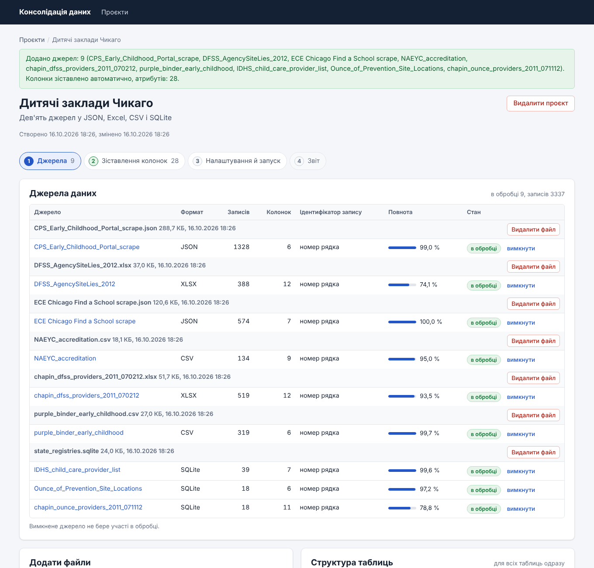

**2. Профіль джерела.** Тип кожної колонки визначено за значеннями, видно пропуски, різні значення й переважний шаблон.

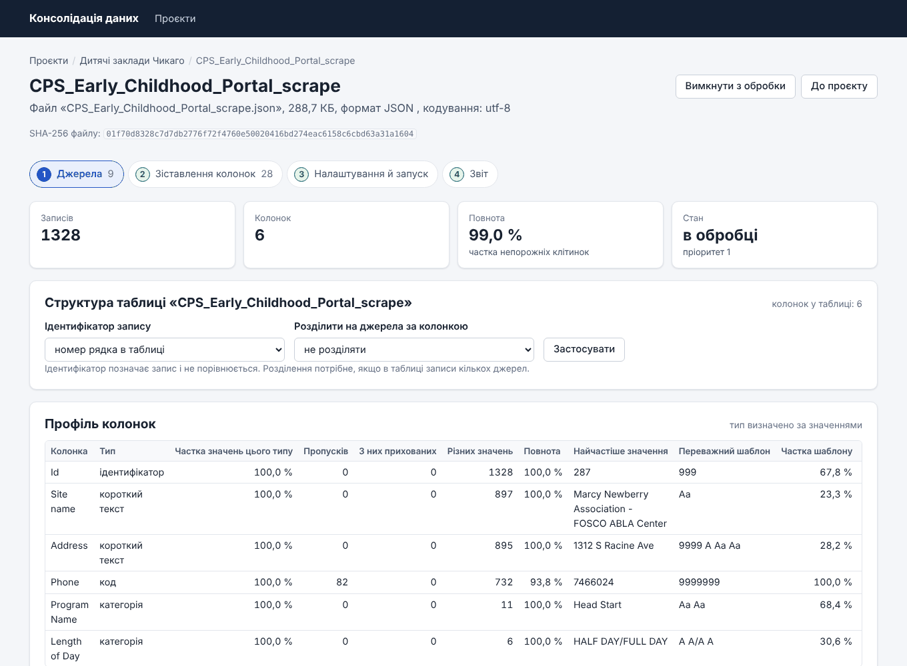

**3. Зіставлення колонок.** Рядок — атрибут результату, праворуч — колонки джерел, з яких він складається. Атрибути можна перейменувати, змінити тип, об'єднати або роз'єднати.

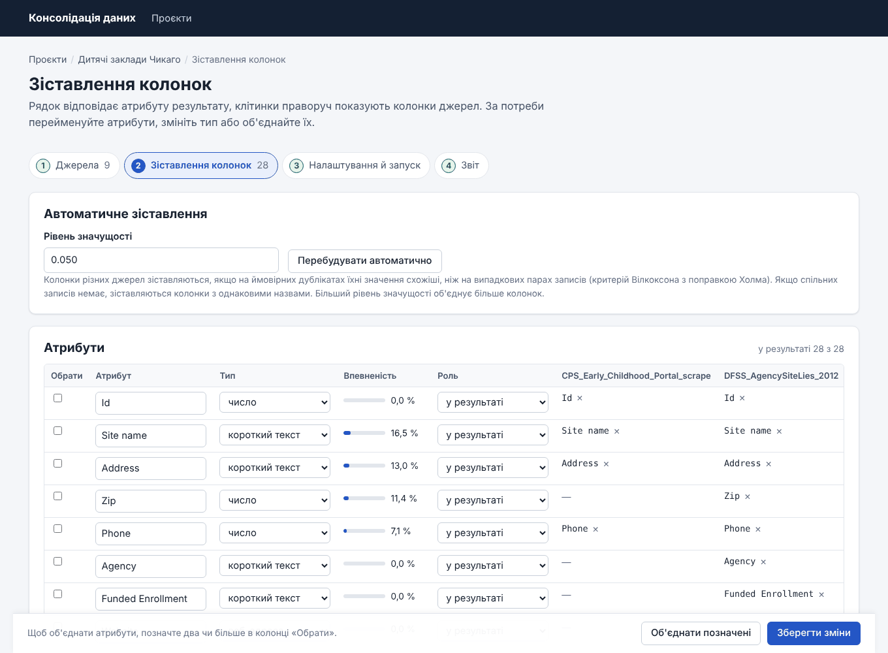

**4. Налаштування.** Формат запису значень, режим пошуку дублікатів, спосіб відбору пар, відновлення пропусків, ваги показників якості. Типові значення підходять для більшості даних.

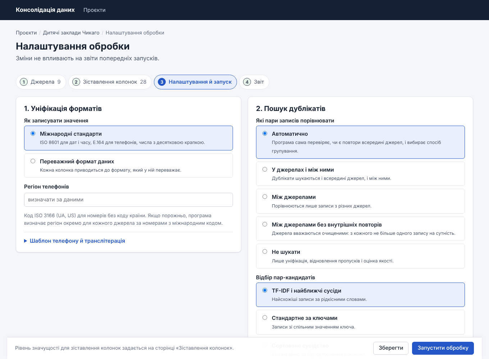

**5. Звіт.** Якість до і після обробки, скільки записів об'єднано, скільки значень уніфіковано й відновлено, попередження, якщо результат варто перевірити, і сама консолідована таблиця. Кольором позначено, де значення взято з іншого джерела, де джерела не погоджувалися, а де пропуск відновлено.

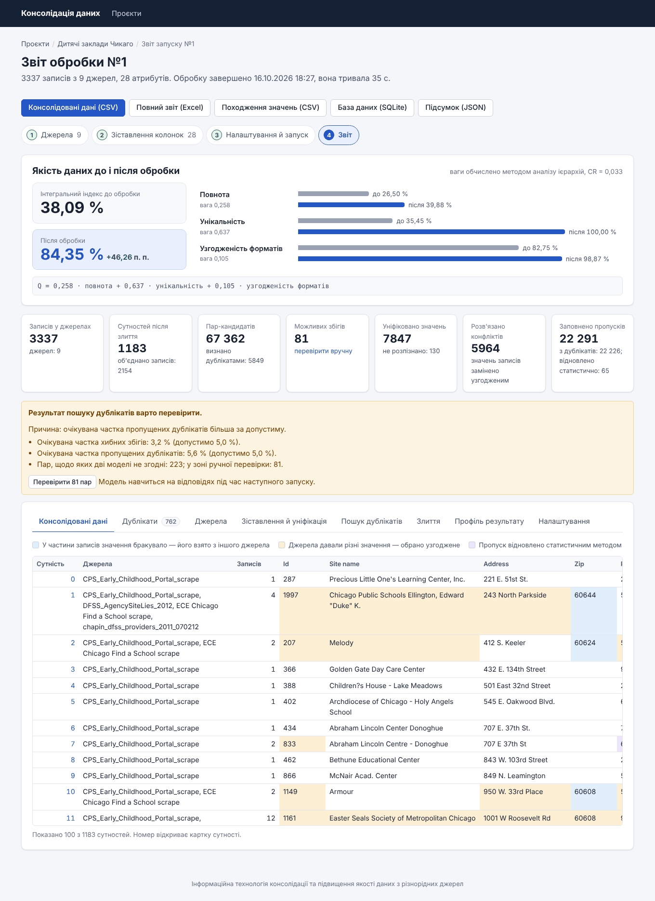

**6. Ручна перевірка.** Найсумнівніші пари поруч, відмінності виділено, для кожного атрибута видно, свідчить він за збіг чи проти. Відповіді враховуються під час наступного запуску.

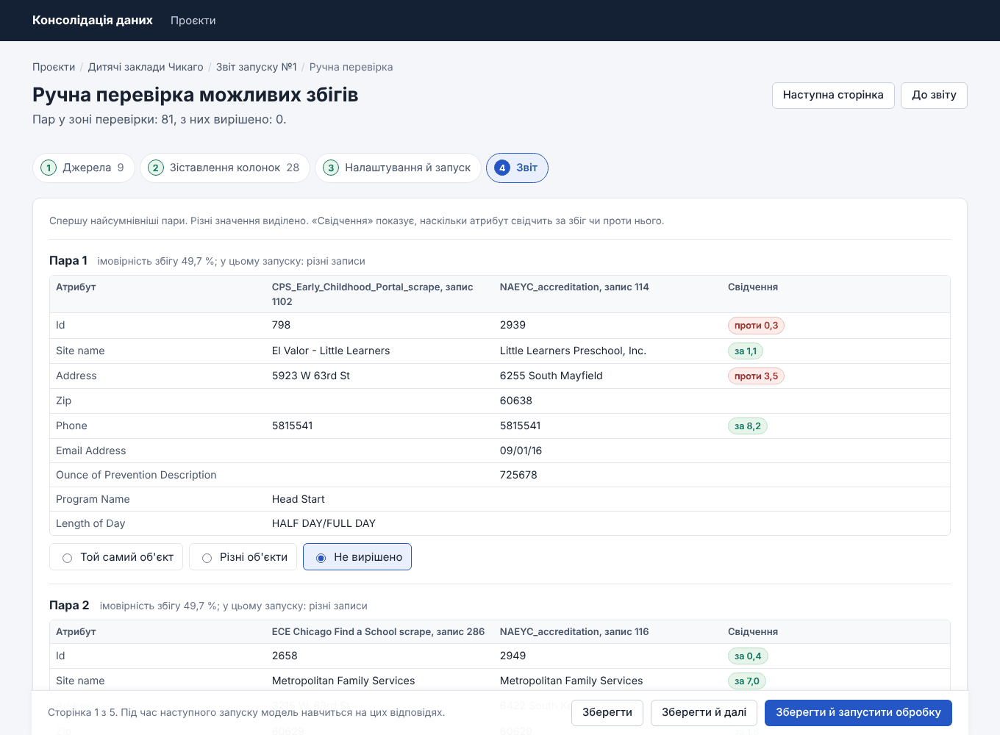

**7. Картка сутності.** Звідки взято кожне значення об'єднаного запису.

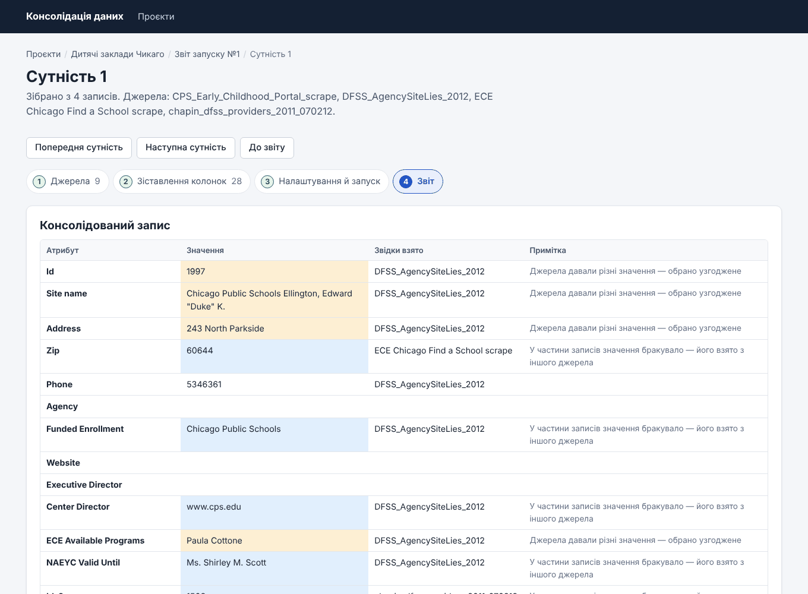

## Архітектура

Ядро `consolidator` не залежить від інтерфейсу; його використовують веб-застосунок і модуль експериментів. Діаграми побудовано в нотації UML, вихідні тексти в PlantUML лежать у `docs/diagrams/`.

### Діаграма варіантів використання

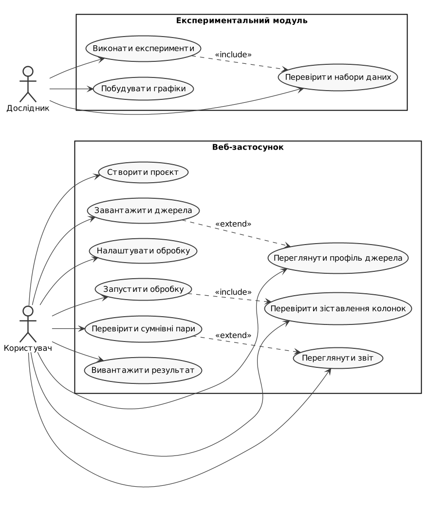

### Діаграма компонентів

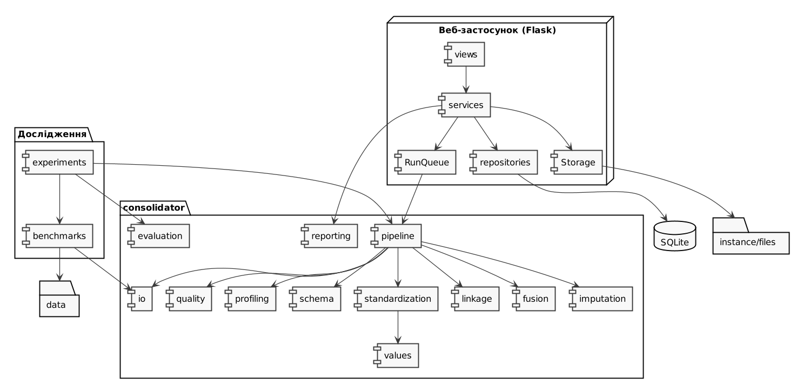

### Діаграма діяльності

Обробка поділена на підготовку, що завершується зіставленням колонок і може бути перевірена користувачем, та консолідацію, яка повторюється після відповідей на сумнівні пари.

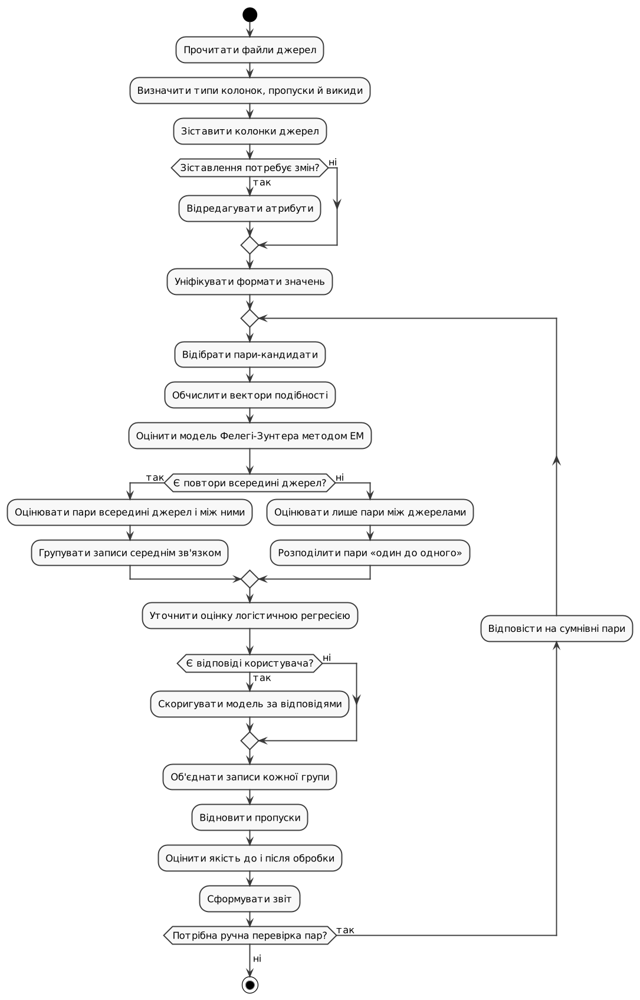

### Діаграми класів

Конвеєр обробки: `Pipeline` виконує етапи послідовно, кожен етап записує результат у спільний `PipelineContext`.

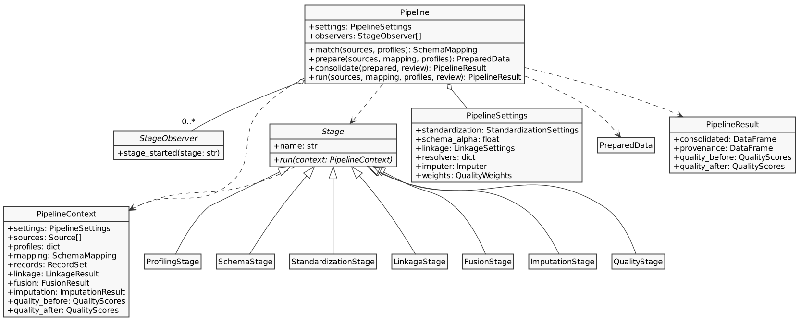

Пакет `linkage`: `Linker` поєднує відбір кандидатів, порівняння, оцінювання й групування, конкретні реалізації яких задаються в `LinkageSettings`.

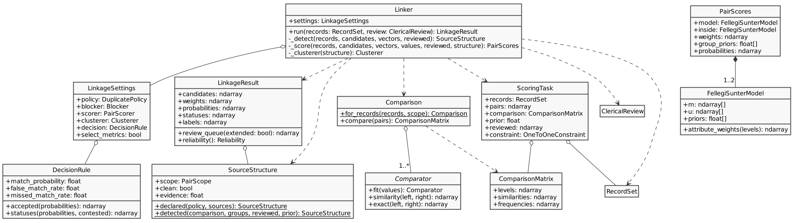

Ієрархії замінних алгоритмів пакета `linkage`:

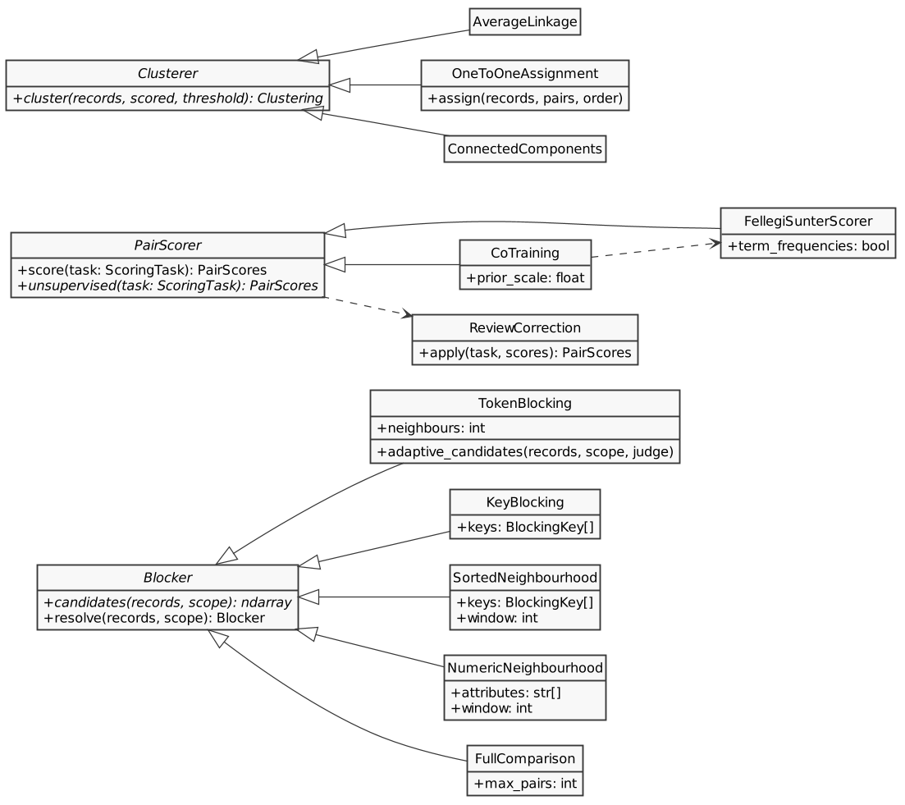

Веб-застосунок: обробники запитів, сервісний шар, репозиторії та черга фонових завдань.

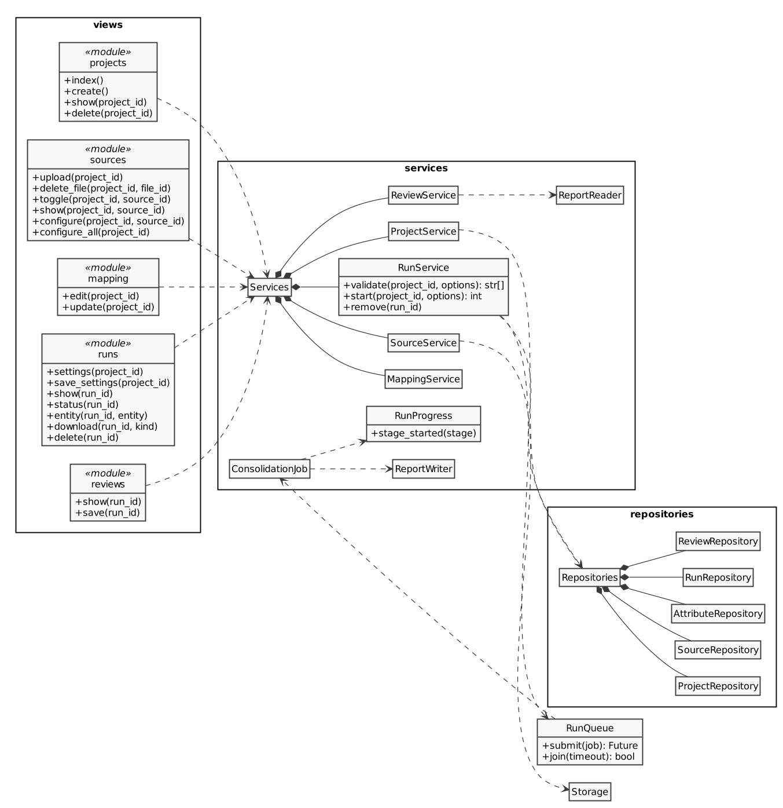

### Діаграма послідовності

Запуск обробки з веб-застосунку: обробка виконується у фоновому потоці, етапи фіксуються в базі даних для відображення прогресу.

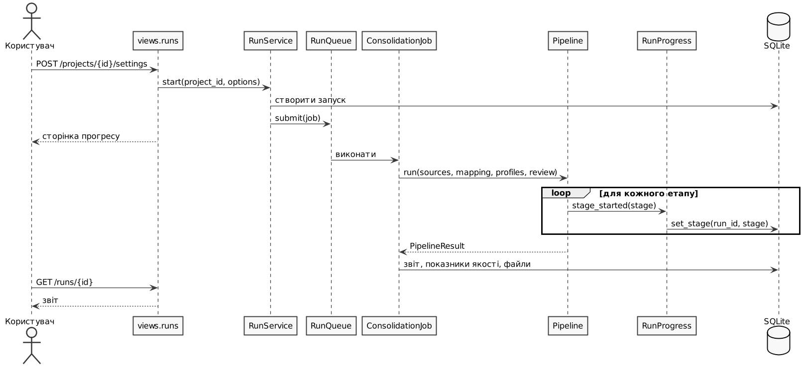

## Алгоритми

| Етап | Метод | Де в коді |
|---|---|---|
| Тип колонки | правила перевіряються по черзі (так/ні, email, URL, рік, дата, час, телефон, число, код, категорія, інакше текст); тип приймається, якщо йому відповідає більшість значень | `profiling/types.py` |
| Викиди | межі Тьюкі (1,5 міжквартильного розмаху) та ізоляційний ліс | `profiling/outliers.py` |
| Зіставлення колонок | для кожної пари джерел беруться взаємно найближчі записи (ймовірні дублікати); колонки вважаються однією ознакою, якщо на цих парах їхні значення схожіші, ніж на випадкових (знаковий ранговий критерій Вілкоксона, поправка Холма, α = 0,05); пари колонок призначаються угорським алгоритмом | `schema/` |
| Відбір кандидатів | TF-IDF за текстовими колонками, для кожного запису k = ⌈log₂ n⌉ найближчих; якщо ймовірні дублікати трапляються в глибшій половині списку, глибина подвоюється. Без текстових колонок — сортоване сусідство за числовими | `linkage/blocking.py` |
| Порівняння | для кожної колонки кілька метрик (TF-IDF на символьних 3-грамах і словах, Джаро–Вінклер, Левенштейн, Жаккар, множини слів, спеціальні для телефонів, чисел, дат); метрика обирається без розмітки за AUC відносно оцінки моделі без цієї колонки. Подібність переводиться в рівні за правилом Стерджеса плюс окремий рівень точного збігу; збіг на рідкісному значенні важить більше | `linkage/comparison.py`, `linkage/selection.py` |
| Ймовірність збігу | модель Фелегі–Зунтера: для кожного рівня подібності оцінюються ймовірності m (серед дублікатів) і u (серед різних записів) алгоритмом EM; ваги монотонні за рівнем (ізотонічна регресія). Профіль дублікатів оцінюється на парах з різних джерел; пари всередині джерела мають власний профіль недублікатів | `linkage/fellegi_sunter.py` |
| Повтори всередині джерел | порівнюються дві моделі для пар усередині джерел: «суміш дублікатів і недублікатів» та «лише недублікати»; рішення за критерієм BIC | `linkage/policy.py` |
| Джерела без внутрішніх повторів | обмеження «один до одного» в EM (ітеративне пропорційне припасування) і жадібний розподіл пар | `linkage/fellegi_sunter.py`, `linkage/clustering.py` |
| Уточнення | спільне навчання: логістична регресія з нормальним апріорним розподілом навчається на ймовірностях моделі Фелегі–Зунтера, оцінки двох моделей поєднуються, кроки повторюються, доки рішення не перестануть змінюватися | `linkage/scoring.py`, `statistics.py` |
| Рішення | пара — збіг, якщо апостеріорна ймовірність ≥ 0,5 (правило Баєса); зона ручної перевірки — за допустимими частками хибних і пропущених збігів | `linkage/decision.py` |
| Групування | середній зв'язок: групи об'єднуються, якщо середня ймовірність збігу між їхніми записами ≥ 0,5, а пари поза кандидатами рахуються як незбіги | `linkage/clustering.py` |
| Відповіді людини | черга сумнівних пар; поправкова логістична регресія поверх моделі, де вихід моделі є зміщенням | `linkage/scoring.py`, `linkage/linker.py` |
| Злиття | зважене голосування з оцінкою точності джерел (модель Accu): точність джерела і ймовірність значення уточнюються по черзі | `fusion/` |
| Пропуски | спершу значення з дубліката; далі середнє або k найближчих сусідів, метод і k обираються перехресною перевіркою | `imputation/` |
| Якість | повнота, унікальність, узгодженість форматів; ваги показників — методом аналізу ієрархій з перевіркою узгодженості | `quality/` |

## Патерни проєктування

| Патерн | Де застосовано | Призначення |
|---|---|---|
| Конвеєр | `Pipeline`, `Stage`, `PipelineContext` | незалежні етапи обробки, які можна тестувати й запускати окремо |
| Стратегія | `Blocker`, `PairScorer`, `Clusterer`, `Comparator`, `ConflictResolver`, `Imputer`, `OutlierDetector`, `ColumnStandardizer`, `FileFormat` | заміна алгоритму через налаштування без зміни решти коду; на цьому побудовано порівняння методів в експериментах |
| Реєстр | `COMPARATORS`, `SCORERS`, `CLUSTERERS`, `RESOLVERS` | вибір реалізації за назвою з налаштувань |
| Шаблонний метод | `PairScorer.score`, `PairScorer.unsupervised` | спільна для всіх моделей послідовність: оцінка без розмітки, далі поправка за відповідями користувача |
| Ланцюжок обов'язків | `TypeDetector`, `TypeRule` | правила визначення типу колонки перевіряються по черзі до першого, що спрацювало |
| Спостерігач | `StageObserver`, `RunProgress` | ядро повідомляє про початок етапу, не залежачи від веб-застосунку |
| Об'єкт-параметр | `ScoringTask`, `ReadOptions`, `PipelineSettings` | передавання узгодженого набору параметрів одним об'єктом |
| Об'єкт-значення | незмінні класи даних (`dataclass(frozen=True)`) | результати й налаштування не змінюються після створення і безпечно передаються між потоками |
| Фабрика застосунку | `webapp.create_app` | окремі екземпляри застосунку для тестів і для роботи |
| Репозиторій | `webapp/repositories` | доступ до бази даних зосереджено в одному шарі |
| Сервісний шар | `webapp/services` | логіка сценаріїв відокремлена від обробників HTTP-запитів |
| Виробник — споживач | `RunQueue`, `ConsolidationJob` | тривала обробка виконується у фоновому потоці |

## Дані для експериментів

Набори в репозиторій не входять (розмір і умови поширення). Їх треба скачати й покласти в `data/raw/` так:

| Набір | Що це | Де скачати | Куди покласти в `data/raw/` |
|---|---|---|---|
| Restaurants | ресторани, 864 записи з 2 довідників | репозиторій [cleanzr/restaurant](https://github.com/cleanzr/restaurant), папка `data` (файли `.RData`) | `linkage/restaurants/` (після перетворення, див. нижче) |
| DBLP-ACM | наукові статті, 2 джерела | [сторінка бенчмарків Лейпцизького університету](https://dbs.uni-leipzig.de/research/projects/benchmark-datasets-for-entity-resolution), архів DBLP-ACM | `linkage/dblp_acm/DBLP-ACM.zip` |
| DBLP-Scholar | наукові статті, 66 879 записів | [та сама сторінка](https://dbs.uni-leipzig.de/research/projects/benchmark-datasets-for-entity-resolution), архів DBLP-Scholar | `linkage/dblp_scholar/DBLP-Scholar.zip` |
| Abt-Buy | товари двох магазинів | [та сама сторінка](https://dbs.uni-leipzig.de/research/projects/benchmark-datasets-for-entity-resolution), архів Abt-Buy | `linkage/abt_buy/Abt-Buy.zip` |
| Amazon-Google | програмні продукти | [та сама сторінка](https://dbs.uni-leipzig.de/research/projects/benchmark-datasets-for-entity-resolution), архів Amazon-GoogleProducts | `linkage/amazon_google/Amazon-GoogleProducts.zip` |
| Geographic Settlements | населені пункти з 4 джерел, назви різними мовами | [та сама сторінка](https://dbs.uni-leipzig.de/research/projects/benchmark-datasets-for-entity-resolution), розділ Multi-source, Geographic Settlements | `multisource/geographicalSettelments.zip` |
| MusicBrainz 20K | пісні з 5 джерел | [та сама сторінка](https://dbs.uni-leipzig.de/research/projects/benchmark-datasets-for-entity-resolution), розділ Multi-source, MusicBrainz 20K | `multisource/musicbrainz-20-A01.csv.dapo` |
| North Carolina Voters | виборці, 5 джерел по 1 млн записів | [та сама сторінка](https://dbs.uni-leipzig.de/research/projects/benchmark-datasets-for-entity-resolution), розділ Multi-source, NC Voters (5 Party, 20 % перетину) | `multisource/5Party-ocp20.tar.gz` |
| Chicago Early Childhood | дитячі заклади, 9 джерел | репозиторій [dedupeio/dedupe-examples](https://github.com/dedupeio/dedupe-examples), файл `csv_example/csv_example_input_with_true_ids.csv` | `consolidation/chicago/chicago_early_childhood.csv` |
| Flights | час рейсів з 38 сайтів | репозиторій [BigDaMa/raha](https://github.com/BigDaMa/raha), папка `datasets/flights`, файли `dirty.csv` і `clean.csv` | `quality/flights/` |
| Beers | крафтове пиво | репозиторій [BigDaMa/raha](https://github.com/BigDaMa/raha), папка `datasets/beers`, файли `dirty.csv` і `clean.csv` | `quality/beers/` |

Файли кладуться як є, розпаковувати архіви не треба.

Restaurants у пакеті записано у форматі R, CSV отримують так (потрібна бібліотека `pyreadr`, вона є в `requirements.txt`):

```
venv\Scripts\python -m scripts.convert_restaurants_rdata <папка з .RData> data\raw\linkage\restaurants
```

Chicago в оригіналі — один CSV. Щоб перевірити роботу з різними форматами, його розбито на 9 джерел у JSON, Excel, CSV і SQLite:

```
venv\Scripts\python -m scripts.prepare_chicago_sources
```

Перевірити, що всі файли на місці й не змінені (контрольні суми SHA-256):

```
venv\Scripts\python -m experiments.e0_verify_datasets
```

Якщо якогось файлу бракує, експерименти не падають, а пишуть, куди його покласти і звідки скачати.

## Експерименти

Усі разом:

```
venv\Scripts\python -m experiments.run_all
```

Окремий — так само, наприклад `venv\Scripts\python -m experiments.e3_blocking`. Таблиці й графіки з'являються в папці `results/`. Повний прогін на ноутбуці з 16 ГБ оперативної пам'яті займає близько 3 годин, найдовший — e3.

| Модуль | Що перевіряє |
|---|---|
| `e0_verify_datasets` | наявність наборів і контрольні суми |
| `e1_similarity_threshold` | метрики подібності, вибір метрики без розмітки, поріг рішення, зона ручної перевірки |
| `e2_fs_vs_linear` | модель Фелегі–Зунтера проти лінійної моделі з ручними вагами і recordlinkage |
| `e3_blocking` | схеми блокування; масштабування на NC Voters |
| `e4_anomalies_imputation` | пошук помилок і відновлення пропусків (Flights, Chicago) |
| `e5_quality_before_after` | індекс якості до і після обробки |
| `e6_comparison` | порівняння з опублікованими результатами |
| `e7_diagnostics` | наскільки далеко до моделі, навченої на повній розмітці |
| `e8_active_learning` | як змінюється результат від 10–50 відповідей людини |
| `e9_robustness` | приховані назви колонок, мало спільних об'єктів, злиті колонки |
| `e10_sensitivity` | чутливість до параметрів |
| `e11_duplicate_share` | той самий набір з різною часткою дублікатів |
| `figures` | графіки за таблицями з `results/` |

## Результати

### Метрики

Програму перевірено на 11 відкритих наборах даних з відомим еталоном, тобто з розміткою того, які записи насправді описують той самий об'єкт. Пошук дублікатів оцінюється за парами записів:

- **Precision** — частка знайдених пар, які справді є дублікатами;
- **Recall** — частка справжніх пар дублікатів, які вдалося знайти;
- **F1** — середнє гармонічне precision і recall.

### Пошук дублікатів

Усі результати отримано без жодної розмітки й без налаштування під конкретний набір: для всіх наборів програма запускалася з тими самими параметрами.

| Набір | Предметна область | Джерел | Precision | Recall | F1 |
|---|---|---|---|---|---|
| NC Voters (20 000 людей) | виборці: ім'я, прізвище, місто, індекс | 5 | 0,998 | 0,985 | **0,991** |
| DBLP-ACM | наукові статті | 2 | 0,955 | 0,985 | **0,970** |
| MusicBrainz 20K | пісні, у кожному джерелі свій формат полів | 5 | 0,993 | 0,934 | **0,963** |
| Restaurants | ресторани з двох довідників | 2 | 0,940 | 0,973 | **0,956** |
| Chicago | дитячі заклади, 9 джерел у 4 форматах | 9 | 0,943 | 0,928 | **0,936** |
| Geographic Settlements | міста, назви різними мовами | 4 | 0,920 | 0,935 | **0,928** |
| Abt-Buy | товари двох інтернет-магазинів | 2 | 0,955 | 0,840 | **0,894** |
| DBLP-Scholar | статті, 66 тис. записів, багато повторів | 2 | 0,911 | 0,837 | **0,872** |
| Amazon-Google | програмні продукти | 2 | 0,280 | 0,720 | **0,404** |

Для порівняння, найкращі опубліковані методи, яким теж не потрібна розмітка, дають на DBLP-ACM 0,962, на DBLP-Scholar 0,845, на Abt-Buy 0,707. Ці числа взято зі статей, вони лежать у `data/published/`.

Порівняння з лінійною моделлю з ручними вагами за різного складу атрибутів:

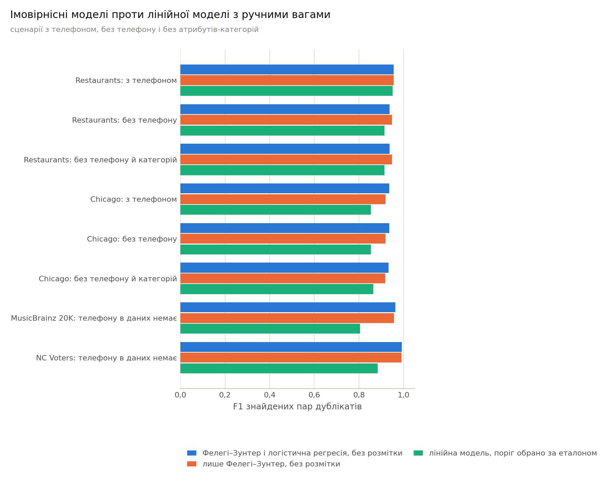

Якість класифікації пар до групування порівняно з моделлю, навченою на повній розмітці з тими самими ознаками:

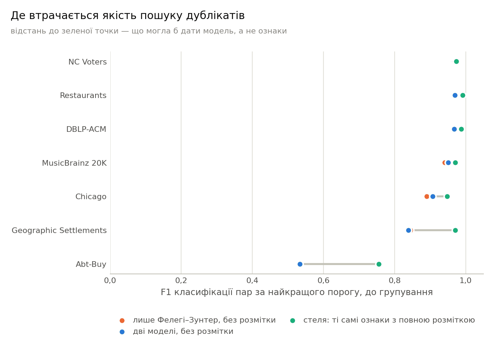

### Інші перевірки

| Що перевірялося | Результат |
|---|---|
| Виправлення помилок у даних про авіарейси (Flights, 38 сайтів) | помилкові клітинки знайдено з F1 0,98, виправлено з F1 0,90; для порівняння, опублікований результат системи HoloClean — 0,76 |
| Відновлення пропусків (Flights) | значенням з дубліката точно відновлено 91 % пропусків, середнім по колонці — менше 1 % |
| Якість до і після обробки (Chicago) | 3 337 записів зведено до 1 175 закладів; унікальність зросла з 0,35 до 0,94 |
| Відповіді людини | на Restaurants після 30 відповідей F1 = 1,0; на Settlements після 50 відповідей F1 зростає з 0,928 до 0,965 |
| Масштаб (NC Voters) | 14 тис. записів — 18 с, F1 0,997; 228 тис. записів — 22 хв, F1 0,915 |
| Приховані назви колонок | на більшості наборів результат майже не змінюється: програма зіставляє колонки за вмістом |

### Графіки

Виявлення неправильних значень і відновлення пропусків у Flights:

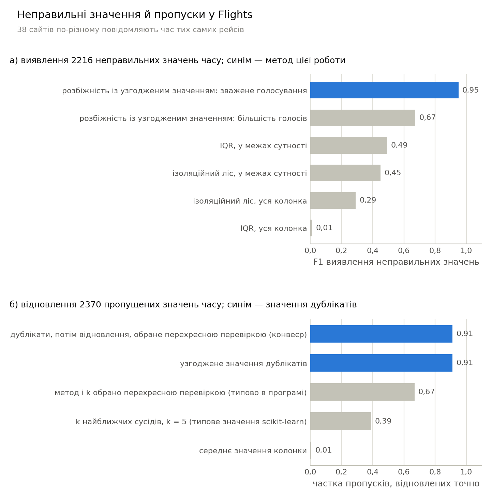

Інтегральний індекс якості до і після обробки:

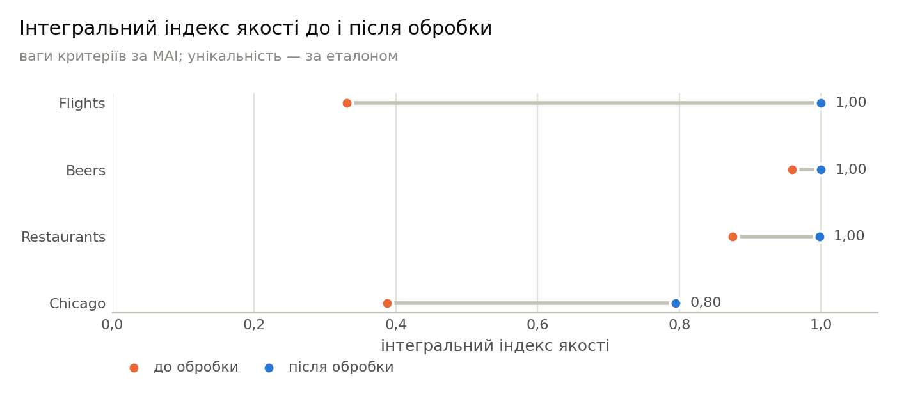

Зміна F1 залежно від кількості відповідей користувача:

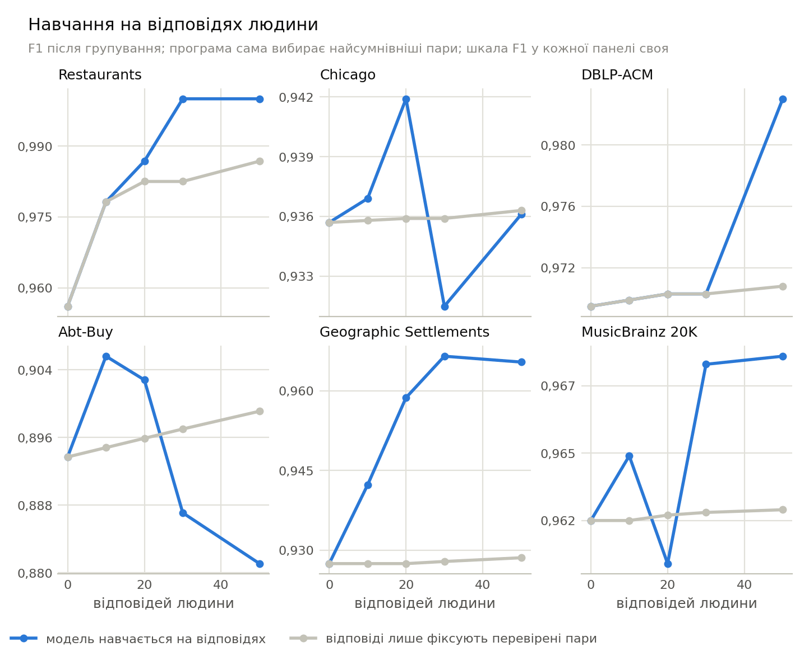

Стійкість до прихованих назв колонок, малої частки спільних об'єктів і злитих колонок:

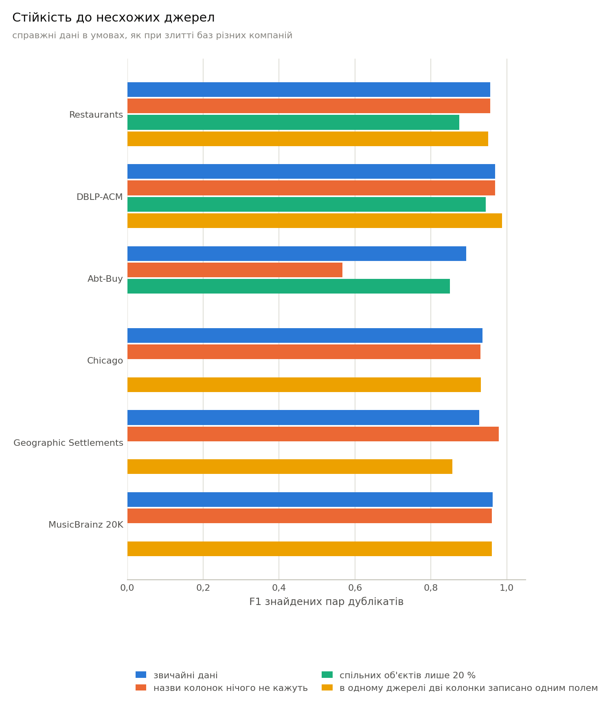

Час обробки NC Voters залежно від обсягу даних:

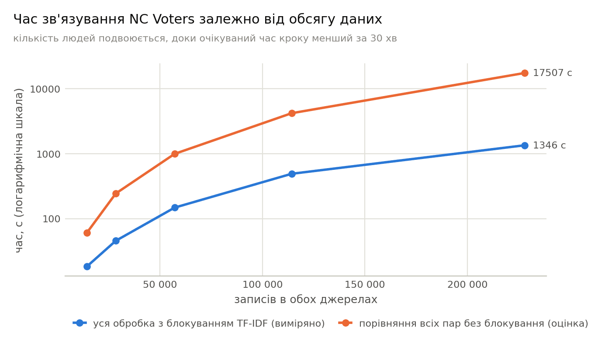

Якість пошуку дублікатів залежно від частки людей, що мають копії:

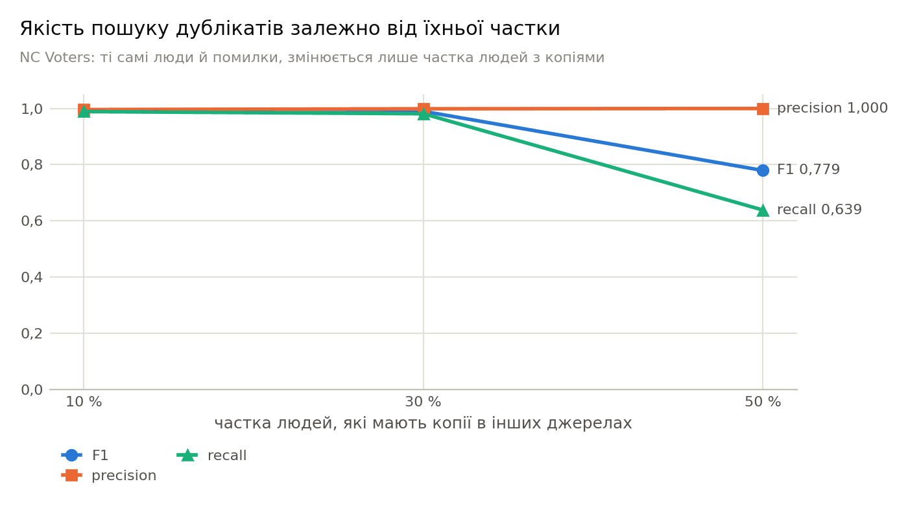

### Обмеження

**Amazon-Google (F1 0,40).** Це найважчий набір серед поширених тестових наборів для пошуку дублікатів. У джерелі Google є багато записів про різні версії того самого продукту: окремі видання, ліцензії, версії для різних систем. Назви й описи таких записів майже однакові, а різниця полягає в одному-двох словах. Програма правильно визначає, що в цьому джерелі є повтори, але не може відрізнити справжню копію від сусідньої версії, тому об'єднує зайве. Звідси висока повнота (0,72) і низька точність (0,28). Розрізнити такі записи можна лише знаючи предметну область або маючи розмічені приклади, а програма навмисно працює без цього.

**Набір Beers (F1 0,30).** Тут потрібно виправити помилки в одній таблиці, а не звести кілька джерел. Програма виправляє значення, звіряючи їх з іншими записами про той самий об'єкт, але в Beers кожне пиво записано один раз, тож звіряти нема з чим. Помилки там переважно у форматі запису («12.0 oz», «0.09%», місто разом зі штатом). Програма приводить такі значення до власного стандартного вигляду, а правильна відповідь у наборі записана за іншими правилами, тому частина змін рахується як помилкова. Цей набір показує, що програма розрахована саме на консолідацію кількох джерел.

**Мало колонок і невідомі назви (Abt-Buy без назв колонок, F1 0,57).** Коли назви колонок нічого не кажуть, програма зіставляє їх лише за вмістом. В Abt-Buy всього три колонки, і дві з них схожі: опис товару зазвичай містить його назву. Через це назву з одного джерела помилково зіставлено з описом з іншого, і порівнюються не ті значення. Якщо колонок більше або вони різніші за вмістом, такої проблеми немає. У веб-застосунку зіставлення можна виправити вручну.

**Дуже багато дублікатів (F1 0,78, коли копії мають половину людей).** Коли копії в інших джерелах мають до 30 % людей, F1 тримається на рівні 0,99. Коли половина, програма майже не помиляється (точність 0,9997), але пропускає третину дублікатів. Імовірна причина в тому, що модель за таких умов недооцінює, наскільки часто трапляються дублікати, і частина справжніх пар не дотягує до порогу. Програма в цьому випадку сама попереджає, що результат варто перевірити вручну.

**Великі обсяги.** Зі зростанням даних якість поступово знижується: F1 0,997 на 14 тис. записів і 0,915 на 228 тис. Чим більше людей, тим більше серед них повних тезок, а частина справжніх дублікатів не потрапляє до кандидатів на порівняння (93 % проти 97 % на малих даних).

На інших комп'ютерах числа можуть відрізнятися в тисячних частках через різні версії бібліотек обчислень.

## Структура

| Папка | Вміст |
|---|---|
| `consolidator/` | ядро: `io` — читання, `profiling` — типи й викиди, `schema` — зіставлення колонок, `standardization` і `values` — уніфікація, `linkage` — пошук дублікатів, `fusion` — злиття, `imputation` — пропуски, `quality` — показники якості, `reporting` — звіти, `pipeline` — усе разом |
| `webapp/` | веб-застосунок на Flask з базою SQLite |
| `benchmarks/` | завантаження наборів з еталонами й перевірка контрольних сум |
| `experiments/` | експерименти й графіки |
| `scripts/` | підготовка похідних файлів даних |
| `data/published/` | опубліковані результати інших авторів для порівняння |
| `docs/` | знімки екрана, діаграми UML з вихідними текстами PlantUML, графіки результатів |
| `tests/` | автоматичні тести |

## Тести

```
venv\Scripts\python -m pytest
```

Тести, яким потрібні набори даних, пропускаються, якщо файлів немає, тому на GitHub Actions проходить лише та частина, що працює без даних. Перевірка стилю — `ruff check .` і `ruff format --check .`.
